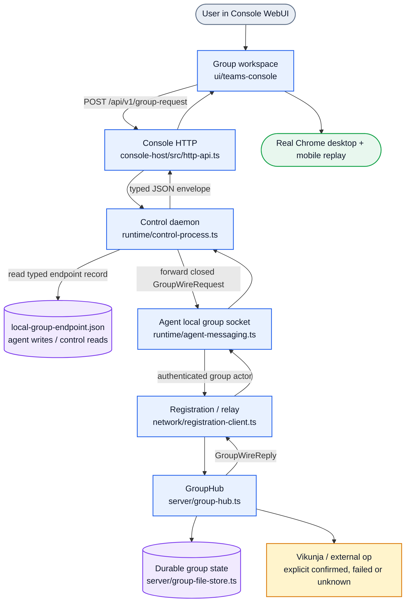
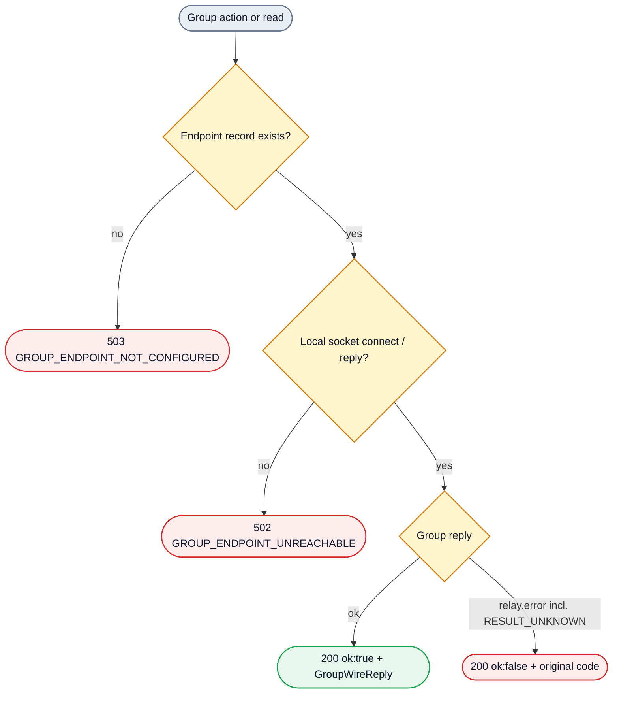
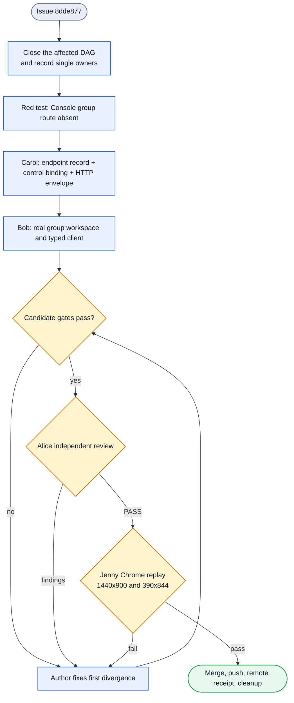

# Group WebUI First Delivery

Issue: `8dde877`

Status: backend/runtime candidate implemented (Carol), frontend in progress (Bob); not a
merge or browser-playback receipt.

Purpose: deliver the first user-usable group workspace in the installed Console
WebUI, backed by the real group owner, with independent desktop and mobile
browser acceptance. The static design HTML is interaction input only. It is not
a production data source.

## 1. Product request path

The user talks to the Console. The Console does not become a group member and
does not own group state. It sends the existing closed group frame through a
typed local boundary to an agent daemon, which remains the authenticated group
actor. The relay and `GroupHub` keep the authoritative membership, message,
issue and action semantics.



The Console stays outside the agent-to-agent data path. Its HTTP route is a
user ingress into one already-authenticated agent's existing local group socket.
It is not a relay, a second `GroupHub`, or a second business-state store.

## 2. Endpoint ownership and error boundary

The frozen v4 `PeerIntent` has no peer `dataDirectory`, so the control daemon
cannot derive an arbitrary agent's local socket. The selected solution is a
typed observation record on the existing account and scope layout:

`<home>/.agentteams/sessions/<accountId>/<scopeId>/<agentId>/local-group-endpoint.json`

- The agent daemon is the single writer. It publishes after its group messaging
  socket starts and removes its own record on graceful stop.
- The control daemon is the single reader. A missing record is
  `GROUP_ENDPOINT_NOT_CONFIGURED`; a present record whose socket cannot be
  reached is `GROUP_ENDPOINT_UNREACHABLE`.
- The record carries only the local socket endpoint and its agent identity. It
  carries no group payload, credential, transcript or second state projection.



`FORBIDDEN`, `UNAVAILABLE`, `UPSTREAM_ERROR`, `RESULT_UNKNOWN` and every other
group error keep their original code and meaning. The UI must never turn an
unknown or refused outcome into success.

## 2b. The implemented HTTP contract (2026-10-24, master confirmation)

The transport route is fixed; the UI client (Bob) consumes exactly this:

```
POST /api/v1/group-request?agentId=<declared peer agent id>
Content-Type: application/json

{ "requestId": "<non-empty string>", "frame": <GroupWireRequest verbatim> }
```

- Exactly one `agentId` query parameter. Missing, duplicated or any extra query
  parameter is `400 {code:"INVALID_INPUT", message}`. The `agentId` must be one
  of this control daemon's declared `intent.peers`; an undeclared agent is
  `400 {code:"INVALID_INPUT", message}` too, never `not-configured`.
- The body takes exactly `requestId` and `frame`. `requestId` must equal the
  frame's own `requestId`, else `400 {code:"INVALID_INPUT", message}`. The frame
  is decoded by the frozen `parseGroupWireRequest`, so an unknown frame kind is
  also a `400`.
- The forwarder receives `{ agentId, request: frame }` verbatim: the transport
  adds no field (the peer's own agent identity is the group owner's actor).
- Responses:
  - `200 {ok:true, reply:<GroupWireReply>}`: the group owner answered.
  - `200 {ok:false, error:{code,message}}`: the group owner answered with
    `relay.error`; code and message travel verbatim, including `RESULT_UNKNOWN`
    (do not replay).
  - `503 {code:"GROUP_ENDPOINT_NOT_CONFIGURED", message}`: the declared peer
    published no record (or this control daemon has no bound group owner).
  - `502 {code:"GROUP_ENDPOINT_UNREACHABLE", message}`: a record exists but the
    socket connect fails, times out or closes before a reply. The wrap message
    keeps the socket client's `do not replay` wording on a timeout.
  - `502 {code:"UPSTREAM_ERROR", message}`: the group forwarder returned an
    error code outside the closed envelope vocabulary (refused at the transport,
    never forwarded to the UI).
- The envelope code vocabulary is closed at the transport: the 13
  `ServiceError['code']` values plus `GROUP_ENDPOINT_NOT_CONFIGURED` and
  `GROUP_ENDPOINT_UNREACHABLE`. The frozen `ServiceError` enum and the group wire
  are not extended.

## 3. First-delivery work flow



## 4. Peer duties and current state

| Owner | Current responsibility | Scope | Done when |
| --- | --- | --- | --- |
| Jenny | Project master: architecture, scheduling, integration, independent frontend acceptance | Issue, DAG, board and final delivery; real browser replay | Desktop and mobile replay pass on the exact candidate, review passed, merged and remote receipt verified |
| Carol | Backend/runtime owner for the typed Console group boundary | `config/local-group-endpoint-store.ts`, `runtime/acp-serve.ts`, `runtime/control-process.ts`, `console-host/src/http-api.ts`, `runtime/vikunja-sync.ts`, focused backend/runtime tests | Endpoint record is agent-written/control-read; route exists; typed errors preserved; issue close/reopen keeps the stable reference; real control-daemon path and tests pass |
| Bob | Frontend/interaction owner for the real group workspace | `ui/teams-console/**`, focused UI tests, typed client only | Real API-backed group list, messages, issues and actions; create/invite/send/action/close flows; responsive desktop/mobile; stable DOM markers |
| Alice | Independent reviewer | Exact candidate review only | PASS or findings with evidence; no author self-review and no substitute for Jenny's browser replay |

Historical offline or managed-subagent records are not current executors. The
unrelated blocked board task is separate and is not reused for this issue.

## 5. User-visible acceptance

The delivered path must:

1. Read groups, members, message pages, issue sessions and actions from the real
   group owner, not from a fixture or the design HTML.
2. Create a group, invite/respond, send a message, create/close an issue, and
   create/submit/report/refuse an action through the typed HTTP envelope.
3. Show loading, empty, refused, unreachable, not-configured and unknown states
   distinctly, with stable DOM markers for replay.
4. Keep the composer visible and the layout free of horizontal overflow at
   `1440x900` and `390x844`.
5. Start in a usable recent-group context when data exists, while keeping all
   navigation and operations reachable on a narrow screen.

## 6. Boundaries and open limits

- First delivery uses explicit HTTP refresh. A UI timer may trigger the real
  API reads, but it is not a source of truth and does not invent group events.
- Group push/SSE is not required for this acceptance. It may be added later
  without changing the typed request semantics.
- One agent daemon exposes one local group socket. The endpoint record is
  therefore peer-scoped; multiple agents require explicit actor selection.
- Public Relay, NAT/STUN, mobile-native entrypoints and a new scheduler remain
  out of scope.
- No implementation, build, review, browser replay, merge or push is claimed by
  this draft.

## 7. Implemented backend/runtime candidate

Source (this candidate): `config/local-group-endpoint-store.ts` (new typed record),
`runtime/acp-serve.ts` (publish on socket start, withdraw on stop and on a failed start),
`runtime/control-process.ts` (`createControlGroupForwarder`, wired into `createConsoleServer`),
`console-host/src/http-api.ts` (route, envelope validation, status mapping).

Focused tests: `config/local-group-endpoint-store.spec.ts`,
`runtime/control-group-forwarder.spec.ts`, `console-host/tests/http-api.spec.ts`,
`runtime/acp-serve.spec.ts` (real agent daemon publishes and withdraws the record),
`runtime/vikunja-sync.spec.ts`.

### 7a. Finding: issue close/reopen erased the stable reference (Vikunja v2.7.1)

A real Vikunja v2.7.1 instance (SQLite, real HTTP API) showed that
`POST /api/v1/tasks/{id}` is a full update, not a partial one:

1. `PUT /api/v1/projects/2/tasks {title, description:"hello [agentteams:test-ref-1]"}`
   returns `200` with `id=1`.
2. `POST /api/v1/tasks/1 {done:true}` returns `200 done=true`, then `GET /tasks/1`
   shows an empty `description`: the stable reference is gone.
3. `PATCH /api/v1/tasks/2 {done:true}` returns `405 Method Not Allowed`, so a
   partial update is not available.

The old `setDone` sent `{done}` only, so every close/reopen erased the
description, and with it the `[agentteams:<ref>]` marker that
`findIssueByStableRef` searches for. A later sync would create a duplicate issue
instead of finding the existing one.

Fix: `setDone` reads the current task first, merges `done` into the fields the
server really returned (`id`, `title`, `description`, `project_id`) and submits
that full body, then keeps the real readback as the reported state. The write is
still sent at most once and an unanswered write still reports `RESULT_UNKNOWN`.
The focused test uses a stub with real full-update semantics (the body replaces
the stored task), so it fails against the old `{done}`-only body.

### 7b. Boundaries kept

- `GroupHub`, `group-registry`, the agent messaging socket protocol, the frozen
  v4 `PeerIntent` fields and the frozen `ServiceError` enum are unchanged.
- The Console never becomes an agent-to-agent relay: it forwards one frame to one
  declared peer's existing socket, and the group owner authenticates the actor.
- The endpoint record carries no group state, credential or transcript.
