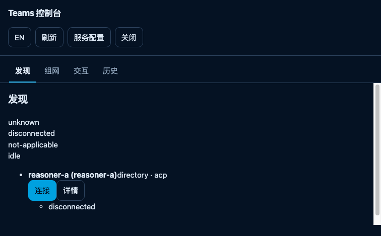

# L11 — installed-artifact live-browser DOM evidence

Unit: `acp-l11-installed-browser-20261014`. Branch `codex/acp-l11-installed-browser-20261014`.
Base `origin/main` = `d835538`. Worktree `/Volumes/Intel/playground/agentteams/acp-l11-installed-browser-20261014`.

## 1. What gap this closes, and what it does not

The project already had a real-Chrome DOM run, `docs/evidence/acp-d08-browser-20261011/live-browser-dom.mjs`
(14 checks, 1 gap). That run drives the WebUI served from the **source worktree**: it runs `pnpm build`
in the worktree and starts the control daemon with `cli/agentteams.mjs` from the worktree. Its own note
and the D07 gate note both say so, and both say that therefore the **installed-copy** replay is a
different evidence level that this run does not close.

This unit runs the same observation one level up. The producer:

1. runs the project's own producer `pnpm build:governance` (`pnpm build && node scripts/package-artifact.mjs --mode final`);
2. `npm pack`s the staged package and `npm install`s the tarball into an isolated prefix **outside the source tree**;
3. starts the registry, one real `--serve opencode` agent daemon (the real installed OpenCode engine behind a
   local OpenAI-compatible stub) and the control daemon, **all from the installed CLI**, with the real TLS
   material the documented `openssl` command produces;
4. proves the running daemons are the installed copy from measurable facts, not from the launch path;
5. launches real Chrome with its own throw-away `--user-data-dir`, injects the Basic credential at the
   **network layer** with `Network.setExtraHTTPHeaders`, and navigates to a **clean origin URL** (no userinfo);
6. reads the live DOM, the page's own authenticated `fetch`, the page's own `EventSource`, and a real SSE frame;
7. byte-compares every asset the browser received against the files the installed package contains;
8. captures a real PNG screenshot into this directory.

**Not claimed by this unit.** It does not claim restart, a deployed-entrypoint replay, a cross-device
receipt, mobile layout, or any control-daemon Session/permission write. Every listener here is loopback:
the LAN two-engine and cross-device claims stay with D05 closure and A11 at their own boundaries. It also
does not claim that `data-team-cancel` or `data-permission-option` render — see §5.

## 2. How to run it

```bash
node docs/evidence/acp-l11-installed-browser-20261014/installed-browser-dom.mjs
```

Env: `CHROME_BIN` (optional Chrome/Chromium override), `OPENCODE_EXECUTABLE` (optional engine override;
the default is the measured `/Users/fanzhang/.opencode/bin/opencode`).

The producer always rebuilds and always re-installs; it never reuses an existing build, because a stale
build silently produces evidence for code that is no longer on disk. It exits 0 on PASS, 1 on any failure
or on a leaked owned pid.

## 3. The canonical run (2026-10-14)

`checks=18 gaps=0 exit=0`. Full output: `installed-browser-dom.log`; structured facts: `receipt.json`.

| # | check | measured |
|---|---|---|
| 1 | staged package | `mode=final release_eligible=false content_sha256=9053205f567f52149035fc4447ec727c28322e26c606880478a13a01de4ffae3 files=263` |
| 2 | isolated install | `agentteams-0.1.0.tgz` packed and `npm install --prefix` into the owned temp root; installed root `<ownedRoot>/prefix/node_modules/agentteams`, CLI `<root>/cli/agentteams.mjs`; the root does not resolve inside the source tree |
| 3 | installed payload | `cli/agentteams.mjs`, `generated/runtime-lib/runtime/control-process.js`, `generated/runtime-lib/runtime/acp-serve.js`, `console-host/static/console.html`, `console-host/static/console-entry.js`, `ui/teams-console/browser.js` all present |
| 4 | daemons from the installed CLI | registry pid 47560 (`127.0.0.1:54500`), agent pid 47754 (`127.0.0.1:54502`, 1 engine child pid 47950), control pid 52006 (`127.0.0.1:54501`) |
| 5 | installed provenance | control command line runs `<install>/generated/runtime-lib/runtime/control-process.js`; agent command line runs `<install>/cli/agentteams.mjs`; the control daemon's own `control-state.json` records `entryPath=<install>/generated/runtime-lib/runtime/control-process.js`; **no** process command line contains the source tree |
| 6 | origin challenge | anonymous `GET /` → 401 `Basic realm="AgentTeams", charset="UTF-8"` |
| 7 | served asset provenance | document sha256 `2b9ebd60…` equals installed `console-host/static/console.html`; `/console-entry.js` = 343 B `d67e55de…` equals installed `console-host/static/console-entry.js`; `/ui/browser.js` = 273 B `7ea6a860…` equals installed `ui/teams-console/browser.js` |
| 8 | chrome launch | real Chrome pid 52814, `--headless=new`, own `--user-data-dir`, DevTools endpoint on a loopback port |
| 9 | page load | clean origin URL (no userinfo), Document 200 `text/html`, `title="AgentTeams Console"`, `readyState=complete` |
| 10 | page module graph | `/console-entry.js` 200 and **18** `/ui/*` modules, all 200; **all 18 byte-match** the installed package |
| 11 | page fetch | the page's own same-origin `fetch('/api/v1/projection')` → 200 `application/json`, 617 B, `version=1 agents=["reasoner-a"]`; same agent set and same frozen empty `sessions`/`notifications`/`configs` as an independent Node read of the same endpoint |
| 12 | DOM markers | `data-team-page` = discovery, networking, interaction, history; `data-team-page-view=discovery`; `data-team-band` = registration, connection, engine, request; `data-band-state` = unknown, disconnected, not-applicable, idle; `data-team-observation=live` |
| 13 | live page subscription | the shipped entry opened its **own** `/api/v1/events` (HTTP 200) and its observation controller reached `live` |
| 14 | real agent row | `data-agent-id=reasoner-a` — the real registered agent from the live directory |
| 15 | SSE frame | a driver-owned `EventSource` received a real `snapshot`: `seq=1`, `agents=["reasoner-a"]` |
| 16 | four pages | the live page switched `discovery → networking → interaction → history`; the history view rendered `data-history-count=0`, 0 record rows, `data-history-prev[data-enabled]=false` |
| 17 | page runtime errors | 0 uncaught page exceptions across 185 CDP events; the only console error is Chrome's generic 404 text, bound by the observed Network table to the expected `/favicon.ico` 404 |
| 18 | screenshot | real PNG **756×469**, 28,255 B, dimensions read from the IHDR chunk and asserted |

Cleanup: owned pids `47560, 47754, 47950, 52006, 52814` all dead, 0 processes matching the owned temp root,
0 processes matching the owned Chrome profile, and the owned temp root removed.



The screenshot is the real rendered discovery page of the installed origin: the four frozen tabs, the four
state bands, and the real `reasoner-a` agent row with its `连接`/`详情` actions and a `disconnected`
connection chip.

## 4. Two defects this producer found in itself

Both were found while making the producer's own assertions meaningful, and both are fixed in the code that
produced the canonical run.

- **Silent no-op module comparison.** The first module-provenance loop rebuilt its request table per module
  and then compared record objects by identity. Because each rebuild produced fresh objects, every lookup
  returned `undefined` and **zero modules were actually compared** while the check still printed a pass
  ("0 of them byte-match"). The producer now builds the table once and asserts
  `comparedModules === moduleEntries.length`, so an uncompared module fails the run instead of passing it.
- **Unnamed console error.** The first run reported "1 log errors observed" without naming them. The
  producer now reports the verbatim texts and binds them to the observed Network table; a console error
  that is not the expected `/favicon.ico` 404 fails the run.

## 5. Honest non-claims and retained obligations

1. **`data-team-cancel` and `data-permission-option` do not render.** They are only emitted for a rendered
   Session (`ui/teams-console/src/client/render.ts:593` and the permission option list). This control daemon
   binds no Session owner, so there is no Session to cancel and no pending permission to choose. Their
   absence is the **same gap the D06/D08 evidence already records**, not a regression, and this unit does
   not treat their absence as evidence. `permission.reply` and the Session send/cancel owners stay unbound.
2. **The history view is empty by construction.** `data-history-count=0` reflects a control daemon whose
   ledger has no `kind=connection` history in this configuration. It proves the marker renders, not that any
   history row is ever produced by this unit.
3. **Whole-document byte equality is not claimed for the projection.** The directory is live, so two reads
   legitimately differ in sequence. What is asserted is the same version, the same registered agent set and
   the same frozen empty interaction arrays.
4. **This run binds loopback only.** The LAN and cross-device claims stay with D05 closure and A11.
5. **The installed-copy item is closed only for the WebUI DOM level.** Restart, deployed-entrypoint replay,
   cross-device receipt and mobile remain open for the D07 gate, which therefore stays `partial`.
6. **`release_eligible=false`** is the project's own value for the final package; this unit does not upgrade it.